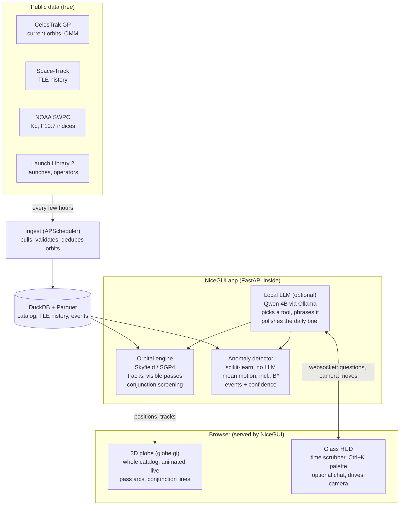

# OrbTrack AI — PRD

_Last updated 2026-10-23. Source: [Claude Doc](https://claude.ai/artifact/5uR3kvNKyEuuAwPUm1z3K2). Build plan: [PLAN.md](PLAN.md)._

## Where it stands today

OrbTrack_AI is a working orbit-propagation prototype in two Colab notebooks. It has no AI, no app, and no SSA (space situational awareness) features yet. The README promises "real-time SSA and satellite monitoring"; the code delivers the first step of that: where satellites are.

| Commit | Date | What it added |
| --- | --- | --- |
| 378d764 | 2025-07-12 | Screenshot of a Plotly 3D globe with the ISS orbit. The code behind it is not in the repo. |
| b4848a9 | 2025-06-16 | `orbtrack_multi-satellite.ipynb`: ISS, Hubble and Terra ground tracks on a Basemap world map, with longitude unwrapping and a "now" marker |
| 9e70641 | 2025-06-16 | `orbtrack_ISSlocation.ipynb`: load CelesTrak TLEs with Skyfield, print the ISS's lat/lon/altitude, plot a 90-minute ground track |
| fff6731 | 2025-06-16 | Initial commit, 2-line README |

**What is solid and worth keeping**

- The core idea is right: TLEs from CelesTrak, propagated with SGP4 via Skyfield. This is the industry-standard public stack.
- You already know ground tracks, subpoints, and the antimeridian wrap problem.

**What needs fixing before building on it**

- Time is hardcoded to `ts.utc(2025, 6, 16, …)`, so the "next 90 minutes" is actually a fixed day in 2025.
- `np` is used in `unwrap_longitudes` but never imported, so the last cells fail on a fresh run.
- The `celestrak.com/NORAD/elements/*.txt` URLs are CelesTrak's legacy endpoints. The current API is `celestrak.org/NORAD/elements/gp.php?GROUP=…&FORMAT=json`, which also returns OMM JSON.
- The second notebook copies the first one cell for cell. There is no shared module, no tests, no dependencies file.
- The 3D globe code was never committed, so that view has to be rebuilt.

## Brainstorm: where to take it

Recommendation: build an **AI space-traffic analyst**, ideas 1 + 2 + 3 below fused into one product. It keeps the README's SSA promise, uses only free public data, and puts AI where it does real work rather than as a chat wrapper.

| # | Idea | What the AI actually does | Wow factor | Effort | Verdict |
| --- | --- | --- | --- | --- | --- |
| 1 | **Ask-the-sky agent** | An LLM agent with orbital tools answers "When can I see the ISS from Bangalore tonight?" or "What is the bright dot moving north-east at 21:42?" by calling a real propagator, not guessing | High, instantly demoable | Medium | Core |
| 2 | **Maneuver & anomaly detector** | Learns each satellite's normal TLE history (mean motion, inclination, drag term) and flags maneuvers, orbit raises, decays and breakups | High, genuine SSA value | Medium–high | Core |
| 3 | **Conjunction watch** | Screens the catalog for close approaches; an LLM turns raw miss distances into a ranked, plain-English risk brief | High | High (O(n²) screening) | Core, scoped to a watchlist first |
| 4 | **Daily space briefing** | An agent writes "what changed in orbit in the last 24 h": new launches, maneuvers, re-entries, close calls, space weather | Medium–high, great for sharing | Low once 1–3 exist | Ships on top |
| 5 | ML-corrected propagation | Trains a model to predict SGP4's error and correct it, using later TLEs as ground truth | Research-grade | High | Later / research track |
| 6 | Re-entry prediction | Predicts decay date from drag history and solar activity | Medium | High | Later |
| 7 | Phone AR sky-finder | Point a camera at the sky, label satellites | Very high | Very high (mobile, sensors) | Out of scope |
| 8 | Earth-observation search | "Which satellite imaged this field yesterday?" plus vision models on Sentinel imagery | High | Very high, different product | Out of scope |

Why this combination: 1 is the front door people enjoy, 2 and 3 are the substance an SSA engineer respects, and 4 is the shareable output that makes it feel alive.

## PRD: OrbTrack AI

**One line:** a gorgeous live 3D view of everything in orbit that runs entirely on your machine, with local AI that spots unusual behaviour and answers questions, all grounded in real orbital math.

**Problem.** Orbit data is public but unreadable. TLEs are cryptic, existing trackers show dots without meaning, and professional SSA tools are expensive or closed. Nobody turns "satellite 44713's mean motion jumped" into "this Starlink just raised its orbit" automatically.

### Users

| User | Wants | First thing they do |
| --- | --- | --- |
| You | A fun, beautiful space toy that keeps teaching you orbital mechanics and applied ML | Opens it in the evening to see what moved today |
| Friends you show it to | A "whoa" in the first 30 seconds | Watches the catalog swirl, clicks the ISS, asks when to see it |

### Goals

1. Every answer about position, passes or approaches comes from a propagator call, never from the LLM's memory.
2. Detect maneuvers and decays from public TLE history with measured accuracy.
3. Make a stranger say "whoa" within 30 seconds of opening the app.

### Non-goals (v1)

- Paid APIs or cloud LLMs. Everything runs locally and free; the LLM is optional.
- Operational collision-avoidance advice. TLE accuracy is not good enough for real maneuver decisions.
- A JavaScript frontend build (npm, React). The codebase stays Python; the only JS is one vendored globe library.
- Multi-user accounts, hosting, mobile, AR, Earth-imagery search.

### Features

| Priority | Feature | Acceptance criteria |
| --- | --- | --- |
| P0 | Live 3D globe of the active catalog | All active satellites render and animate smoothly on your laptop; click one to follow it |
| P0 | Orbital engine | Position, ground track, visible passes for a location, close approaches for a watchlist; each a tested Python function |
| P0 | Time machine | Scrub, pause, rewind and fast-forward time; every layer follows the clock |
| P1 | Maneuver & anomaly detector (no LLM) | Nightly scikit-learn job over Space-Track history; events with type, time, confidence and a reason |
| P1 | Conjunction watch | Watchlist screening for the next 72 h; ranked by miss distance, replayable on the globe |
| P1 | Command palette | Ctrl+K: "ISS", "passes tonight", "Starlink", "maneuvers this week"; works with the LLM switched off |
| P2 | Ask-the-sky chat (local Qwen 4B) | Free-text questions routed to engine tools; answers show on the globe |
| P2 | Daily brief | Built from events by templates; Qwen optionally rewrites it as friendly prose |
| P2 | Space weather context | Kp and F10.7 from NOAA beside decay and drag events |

### UI vision: "mission control at night"

The UI is the product. It should feel like a film's mission-control screen that happens to be accurate.

- **The globe:** a dark Earth with a glowing atmosphere rim, city lights on the night side, and a real-time terminator line where the Sun is setting.
- **The swarm:** every active satellite as a glowing particle, coloured by orbit (LEO, MEO, GEO, Starlink). Fast-forward to 1000× and watch Starlink trains and GEO's still ring.
- **Follow cam:** click any satellite and the camera locks on, its orbit traced as a fading comet trail, with a HUD showing altitude, speed and next pass over you.
- **Your sky:** a second view looking up from your city, a dome showing what is above the horizon right now and tonight's passes as arcs.
- **Event pulses:** maneuvers and close approaches appear as rings pulsing on the globe; click one to replay it, with both orbits converging.
- **Glass HUD:** translucent panels, monospace telemetry, a timeline scrubber along the bottom, and a Ctrl+K command palette.

### Success metrics

| Metric | Target |
| --- | --- |
| Pass predictions vs. a reference tracker (e.g. Heavens-Above) | Start and end time within 60 s for the ISS |
| Globe performance | Full active catalog animating at 60 fps on your laptop; first frame in under 3 s |
| Qwen tool routing on a 50-question eval set | Right tool and arguments for at least 90%; orbital numbers always come from the tool, never the model |
| Maneuver detector on a labelled set (ISS reboosts, a GEO station-keeping set) | Recall ≥ 80% at precision ≥ 70% for v1 |
| Fun | You still open it weekly a month after Phase 6 |

## Architecture

Everything is one Python process on your laptop, free to run. The AI comes in two halves: classic ML that is always on and needs no LLM, and a local Qwen 4B that is a nice-to-have. Unplug Ollama and every feature except free-text chat still works.

Data flows down from free public sources into a local DuckDB file. NiceGUI serves the browser UI and pushes satellite positions to it over a websocket, so there is no separate frontend to build.

| Layer | Choice | Why |
| --- | --- | --- |
| UI framework | NiceGUI | Pure Python, built on FastAPI, dark Quasar components, and custom elements for anything WebGL |
| 3D globe | globe.gl (three.js), vendored JS files wrapped as a NiceGUI element | The best-looking globe you can get without a JS build: atmosphere glow, night lights, particle layers, arcs and trails |
| Propagation | Skyfield + `sgp4` (`SatrecArray`, vectorised) | What you already used; NumPy-fast for the whole catalog |
| Storage | DuckDB + Parquet | No database server; fast SQL over years of TLE history in one file |
| Scheduling | APScheduler inside the app | Fetches CelesTrak, Space-Track and NOAA on a timer without cron |
| Detector | Features on TLE deltas, then isolation forest / gradient boosting (scikit-learn) | Runs in seconds on a laptop; easy to evaluate and explain |
| LLM (optional) | Qwen 4B via Ollama's chat API with tools and JSON-schema output | Free and local; kept to routing and phrasing, where a small model is reliable |
| Charts and HUD | Plotly or ECharts through NiceGUI, glass styling with Tailwind classes | Same look across globe and panels |

**Making a 4B model behave.** Small models are weak at long reasoning and free-form tool use, so the design does not ask for either:

1. Few tools, about six, with tight JSON schemas (`find_satellite`, `next_passes`, `close_approaches`, `recent_events`, `fly_to`, `set_time`).
2. Ollama's structured output forces valid arguments; a bad call is retried once, then falls back to the command palette's keyword parser.
3. Numbers in answers are filled from tool results by a template. Qwen only writes the sentence around them, so it cannot invent a pass time.
4. A 50-question eval set runs locally with `pytest`, so you can swap in a newer model and see if it is better.

## Risks and open questions

| Risk | Why it matters | Mitigation |
| --- | --- | --- |
| "Python only" caps how cool the globe can look | Every great 3D globe is WebGL, which means JavaScript | One vendored globe.gl file wrapped as a NiceGUI element; you write Python, the library draws. Phase 2 proves it first |
| Tens of thousands of moving points in the browser | Laggy animation kills the wow | Propagate in NumPy on the server, send compact position arrays a few times a second, let the GPU interpolate between them |
| A 4B model routes questions badly | Wrong answers, frustration | Few tools, JSON-schema output, templated numbers, keyword fallback, and an eval to measure it |
| TLE accuracy is about a kilometre or worse, and grows with age | Close-approach numbers can look more precise than they are | Show TLE age and an uncertainty note on every approach |
| Few public maneuver labels | The detector cannot be measured without ground truth | Start with known events (ISS reboosts, GEO station-keeping); try the MIT ARCLab pattern-of-life dataset; hand-label 100 events |
| Space-Track and CelesTrak usage rules | Getting your account throttled | Cache everything in DuckDB, bulk history download once, then small daily updates within each site's published limits |
| Scope creep | "Cool space + AI" has no natural end | Each phase ends in a demo; ideas 5–8 from the brainstorm stay parked until Phase 6 ships |

**Decisions so far**

- Personal passion project, built for fun: polish and delight beat production hardening.
- Python only: NiceGUI + globe.gl, no JS build.
- No cloud AI. Local Qwen 4B via Ollama, used only where it helps, and optional.
- Free Space-Track.org account: yes, for TLE history.

**Still open:** your home location for the "your sky" view and pass tests, and roughly how many evenings a week you want to spend (pace no longer matters: phases have no deadlines).
